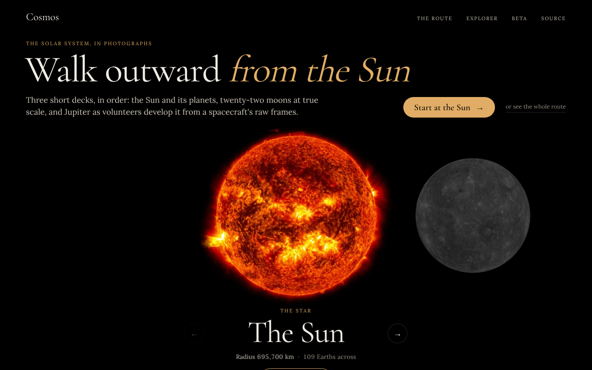

# Cosmos

**Live site: https://protonmatter.github.io/cosmos/**

A landing page, three presentation decks on the solar system — the planets, the moons, and
JunoCam — the JunoCam explorer and poster, and a beta iOS prototype called the Pocket
Planetarium. Built as standalone HTML: no build step and nothing to install. Open any file
in a browser, or serve the folder.

[`index.html`](index.html) is the interactive landing page. It links every deck, the beta
preview, and on to [Sol](https://protonmatter.github.io/sol/).



## What's here

| File | Format | What it covers |
| --- | --- | --- |
| [`index.html`](index.html) | landing | Showcase page for the collection, with links to the beta and through to Sol |
| [`solar-system.dc.html`](solar-system.dc.html) | 13 slides | The Sun, the eight planets and the Moon — one card each, with radius, mass, gravity, rotation, tilt, temperature, atmosphere and field strength |
| [`the-moons.dc.html`](the-moons.dc.html) | 18 slides | Twenty-two moons across five systems: Mars, the Galileans, Saturn's ice moons and Titan, the Uranian five, Neptune's three |
| [`junocam-deck.dc.html`](junocam-deck.dc.html) | 11 slides | JunoCam itself: the instrument, why its images arrive as raw strips, and the volunteers who process them |
| [`junocam-explorer.dc.html`](junocam-explorer.dc.html) | interactive | The thirty processed Jupiter frames from their full-size originals, each credited to its processor, filterable by region and treatment, with a zoomable viewer and a side-by-side compare mode |
| [`junocam-poster.dc.html`](junocam-poster.dc.html) | 18 × 24 in | A single printable sheet on the same subject, fitted to the window on screen |
| [`beta.html`](beta.html) | landing | Preview page for the beta, introducing the Pocket Planetarium |
| [`pocket-planetarium.html`](pocket-planetarium.html) | beta / iOS | A scroll-driven journey from the Sun out to Neptune, with the moons and the JunoCam gallery below |

The decks are 1920 × 1080 and scale to fit the window. The poster prints at 18 × 24 inches.

The pages are plain HTML that declare their content declaratively; `support.js`,
`deck-stage.js` and `deck-cinema.js` provide the slide runtime, and `classical.css` the
shared look. `deck-full-bleed.css` is the layout the Solar System deck's body slides
use: one photograph filling the slide, the facts over it, and a button that opens the
image at full resolution ([RFC 0005](docs/rfcs/0005-full-bleed-decks.md)).
`deck-dark.css` is the rest of that look, for slides that compare several bodies, set
out a table or pair two photographs; the Moons and JunoCam decks are built from it
([RFC 0006](docs/rfcs/0006-one-look-for-every-deck.md)).
`deck-upright.js` and `deck-upright.css` give every slide a second layout for a phone
or small tablet held upright: a page the shape of the screen, picture above words, turned with a
swipe ([RFC 0008](docs/rfcs/0008-decks-on-an-upright-phone.md)).

## Pocket Planetarium (beta)

An early iOS prototype of Cosmos as a single scrollable app: the Sun, eight planets,
twenty-two moons and the thirty JunoCam photographs. [`beta.html`](beta.html) introduces
it and, on a desktop browser, presents it inside a simulated 390 × 844 device frame:


On an iPhone, open [`pocket-planetarium.html`](pocket-planetarium.html) full screen
instead for the intended experience:


Its assets live under [`beta/pocket-planetarium/`](beta/pocket-planetarium/). This is a
prototype, not a release — the decks are unaffected by anything in it.

## Using them

Open a file directly, or serve the folder:

```
python3 -m http.server 8000
```

then visit `localhost:8000/` for the landing page (or any file above).

Arrow keys or space advance the decks. Print to PDF gives one page per slide.

## Development

The site has no build step and never will — the pages open straight from the
filesystem. The tooling below tests the site; it does not build it, and nothing it
installs is served or deployed.

```bash
npm install
npm run serve   # http://localhost:8000
npm test        # validation, traceability, functional, e2e, regression
```

Substantive changes are proposed as an [RFC](docs/rfcs/), specified as numbered
requirements in [`docs/specs/`](docs/specs/), and covered by tests that name the
requirement they discharge. [`docs/SDLC.md`](docs/SDLC.md) walks through the whole
path from idea to production, and [`CONTRIBUTING.md`](CONTRIBUTING.md) has the
practical detail.

## Publishing on GitHub Pages

[`.github/workflows/pages.yml`](.github/workflows/pages.yml) deploys the repo root on
every push to `main` (Settings → Pages → Source: *GitHub Actions*), but only after the
same quality gate that guards pull requests has passed. If the gate is red the live
site is left untouched.

React, ReactDOM and Babel are vendored under `vendor/`, so every page carries no CDN
dependency and works offline; only the Google Fonts stylesheet is fetched remotely.
That now includes the Pocket Planetarium prototype, which is served by a separate
copy of the runtime: it was the one exception until
[RFC 0003](docs/rfcs/0003-vendored-runtime-for-the-beta.md) pointed it at the same
vendored bundles.

## Where the numbers come from

Every figure in the decks is read from the body and satellite tables in
[Protonmatter/sol](https://github.com/Protonmatter/sol) — `apps/web/js/bodyData.js` and
`apps/web/js/moons.js` — which cite the NASA Planetary Fact Sheets and IAU WGCCRE 2015
(Archinal et al. 2018) for radii and rotation. The descriptive text is that project's own,
unchanged.

Each deck ends with a sources slide giving per-image provenance.

## Image credits

Spacecraft imagery is NASA/JPL-Caltech and partner institutions, in the public domain:

- **Sun and planets** — SDO (Sun), MESSENGER (Mercury), Magellan (Venus), DSCOVR (Earth),
  Viking (Mars), JunoCam (Jupiter), Cassini (Saturn), Voyager 2 (Uranus, Neptune)
- **Moons** — Voyager 1 and 2, Galileo, Cassini–Huygens, Juno, Mars Reconnaissance Orbiter
- **Jupiter and Io frames** (`images/`) — JunoCam raw data processed by volunteers, from
  the [Mission Juno citizen-processing
  gallery](https://www.missionjuno.swri.edu/junocam/processing)
  (NASA/JPL-Caltech/SwRI/MSSS)

All thirty frames were traced to their entries in that gallery by comparing
pictures, and the explorer, the JunoCam deck and the poster show them from the
processors' own full-size files. Each is credited where it is shown. The name is
the one the gallery's credit line gives; where the gallery gives only an account
name, that is what appears here.

| Frame | Processed by | Gallery entry | Original |
| --- | --- | --- | --- |
| `01-turbulent-south` | Giulio Macrì | [17822](https://www.missionjuno.swri.edu/junocam/processing?id=17822) | 7,214 × 11,240 |
| `02-south-polar` | Jackie Branc | [17819](https://www.missionjuno.swri.edu/junocam/processing?id=17819) | 5,871 × 3,303 |
| `03-southern-ovals` | Jackie Branc | [17823](https://www.missionjuno.swri.edu/junocam/processing?id=17823) | 8,000 × 6,000 |
| `04-limb-terminator` | Jackie Branc | [17811](https://www.missionjuno.swri.edu/junocam/processing?id=17811) | 7,816 × 4,950 |
| `05-golden-filaments` | Raihan Mohammad | [17777](https://www.missionjuno.swri.edu/junocam/processing?id=17777) | 2,520 × 1,588 |
| `06-blue-north` | Raihan Mohammad | [17776](https://www.missionjuno.swri.edu/junocam/processing?id=17776) | 1,509 × 2,683 |
| `07-low-light` | ShanieMoorey | [17775](https://www.missionjuno.swri.edu/junocam/processing?id=17775) | 4,961 × 3,508 |
| `08-banded-hemisphere` | Raihan Mohammad | [17705](https://www.missionjuno.swri.edu/junocam/processing?id=17705) | 1,457 × 819 |
| `09-north-dome` | Gerald Eichstädt and Jackie Branc | [16957](https://www.missionjuno.swri.edu/junocam/processing?id=16957) | 6,884 × 3,872 |
| `10-blue-vortex-field` | Gerald Eichstädt and Jackie Branc | [16959](https://www.missionjuno.swri.edu/junocam/processing?id=16959) | 6,092 × 3,428 |
| `11-pale-dome-oval` | Gerald Eichstädt and Jackie Branc | [16958](https://www.missionjuno.swri.edu/junocam/processing?id=16958) | 7,638 × 4,296 |
| `12-jonsson-bright` | Björn Jónsson | [16969](https://www.missionjuno.swri.edu/junocam/processing?id=16969) | 1,646 × 2,520 |
| `13-jonsson-dark` | Björn Jónsson | [16968](https://www.missionjuno.swri.edu/junocam/processing?id=16968) | 1,646 × 2,520 |
| `14-crescent-north` | YanaDJ | [16966](https://www.missionjuno.swri.edu/junocam/processing?id=16966) | 1,600 × 1,600 |
| `15-vortex-grain` | Gerald Eichstädt and Thomas Thomopoulos | [16962](https://www.missionjuno.swri.edu/junocam/processing?id=16962) | 1,836 × 1,840 |
| `16-merging-storms` | Gerald Eichstädt and Thomas Thomopoulos | [16963](https://www.missionjuno.swri.edu/junocam/processing?id=16963) | 3,108 × 3,108 |
| `17-tall-crescent-a` | Gerald Eichstädt (submitted by Maquet-80) | [16940](https://www.missionjuno.swri.edu/junocam/processing?id=16940) | 1,800 × 5,400 |
| `18-tall-crescent-b` | Gerald Eichstädt (submitted by Maquet-80) | [16939](https://www.missionjuno.swri.edu/junocam/processing?id=16939) | 1,800 × 5,400 |
| `19-vortex-soft` | Andrea Luck | [16931](https://www.missionjuno.swri.edu/junocam/processing?id=16931) | 1,800 × 1,800 |
| `20-orange-band-dome` | Jackie Branc | [16917](https://www.missionjuno.swri.edu/junocam/processing?id=16917) | 7,168 × 4,032 |
| `21-grs-crescent` | Alexey_Hammer | [16874](https://www.missionjuno.swri.edu/junocam/processing?id=16874) | 1,760 × 1,676 |
| `22-pale-oval-closeup` | Navaneeth Krishnan S | [15518](https://www.missionjuno.swri.edu/junocam/processing?id=15518) | 2,000 × 1,552 |
| `23-banded-orange` | Kevin M. Gill | [15517](https://www.missionjuno.swri.edu/junocam/processing?id=15517) | 1,722 × 837 |
| `24-io-wide` | Iva Forkapa | [15462](https://www.missionjuno.swri.edu/junocam/processing?id=15462) | 1,350 × 1,080 |
| `25-io-tall` | Iva Forkapa | [15463](https://www.missionjuno.swri.edu/junocam/processing?id=15463) | 1,080 × 1,350 |
| `26-brown-barges` | Tanya Oleksuik | [15420](https://www.missionjuno.swri.edu/junocam/processing?id=15420) | 2,499 × 1,406 |
| `27-full-disc` | Rachel Richards | [15051](https://www.missionjuno.swri.edu/junocam/processing?id=15051) | 2,400 × 3,000 |
| `28-jupiter-with-io` | Meaghans_scopeR2 | [17095](https://www.missionjuno.swri.edu/junocam/processing?id=17095) | 787 × 555 |
| `29-grs-square` | Reaves-84 | [17853](https://www.missionjuno.swri.edu/junocam/processing?id=17853) | 800 × 800 |
| `30-grs-wide` | Raihan Mohammad | [17718](https://www.missionjuno.swri.edu/junocam/processing?id=17718) | 1,655 × 931 |

The pages serve these as `images/<frame>-<width>.webp`, at up to 4,096 pixels
wide. The `images/*.png` files are 960 pixel copies of the same pictures, matching
the previews the gallery serves. The Pocket Planetarium shows all thirty of them in
its gallery, through `beta/pocket-planetarium/cosmos-data.js`.

The Solar System deck shows four bodies from larger originals than the rest of the
site uses, all NASA and in the public domain:

| Body | Image | Credit |
| --- | --- | --- |
| Venus | Magellan radar globe, [PIA00104](https://science.nasa.gov/photojournal/venus-computer-simulated-global-view-centered-at-180-degrees-east-longitude/) | NASA/JPL |
| Earth | Blue Marble 2012, Suomi NPP, [PIA18033](https://www.jpl.nasa.gov/images/pia18033-earth/) | NASA |
| The Moon | [LRO wide-angle camera near-side mosaic](https://lroc.im-ldi.com/visit/exhibits/1/gallery/17) | NASA/GSFC/Arizona State University |
| Jupiter | Cassini true-colour portrait, [PIA04866](https://www.jpl.nasa.gov/images/pia04866-cassini-jupiter-portrait/) | NASA/JPL/Space Science Institute |

The deck's cover image, `planets/lineup-<width>.webp`, is drawn from the other images
by `tools/cover-lineup.py`. The rest of the deck's images are the `planets/<name>-<width>.webp` files, written by
`tools/image-variants.py`. The Moons deck's images are the `moons/<name>-<width>.webp`
files, and the JunoCam deck's, the explorer's and the poster's are
`images/<frame>-<width>.webp`, written the same way.
The older `planets/*.png`, `moons/*.png` and `images/*.png` files remain because the
Pocket Planetarium still uses them: all thirty of the `images/` frames, and some of
the others.

Two files are **not** public domain and are used under **CC BY 4.0**: `textures/moon.jpg`
and `textures/saturn_ring.png`, from [Solar System
Scope](https://www.solarsystemscope.com/textures/), which composites NASA source data.

Some small or distant moons are shown as enlarged crops of low-resolution frames — Nereid
especially, which Voyager 2 resolved to only a few dozen pixels. The sources slides say
which.

Typography is Cormorant Garamond and Lora, both under the SIL Open Font License.

## Licence

Deck code and layout: MIT, see [`LICENSE`](LICENSE). Imagery and figures keep the terms
above; MIT does not extend to them.
